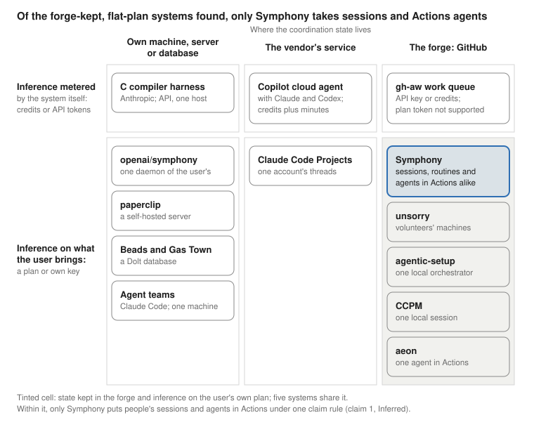

# Symphony versus competitors

A direct comparison of Symphony with the systems that do, or seem to do, its job,
built on the taxonomy spec and manual of 2026-10-15 (docs/checkpoints/2026-10-15b/taxonomy/).
Written 2026-10-16 for the owner's use with reviewers and funders; every claim names
the spec section, the manual section or the source it rests on, with the spec's grades.
The living copy, which can be exported to PDF or Word, is the Claude Doc
https://claude.ai/code/artifact/a1cb9900-9020-49ec-8d96-6781a0d3a523; this file is its
text as of the date above, kept here so the research accumulates in the repository.
The placement figure the Head to head section refers to is symphony-versus-competitors-figure.svg
beside this file. Added on 2026-10-17, and not yet in the Claude Doc: GNAP under the first kind of system, from symphony-versus-gnap.md, and microsoft/conductor and Agentastic under the third, with what they do better, from conductor-and-agentastic.md.

## The answer

Symphony makes a GitHub repository the coordinator of Claude Code agents, with no server of its own. Issues are the queue. A claim is the push that creates branch claude/N, and git lets exactly one of two racing creations win. The board, the release of idle claims and the landing order of overlapping work are GitHub Actions jobs over GitHub's own objects, and a required check decides what merges ([spec](https://github.com/OpenSpineConsortium/symphony-template/blob/main/docs/checkpoints/2026-10-15b/taxonomy/spec.md), sections 2 and 9.1).

Against every competitor found, Symphony is better by design in three respects that no other system has in this form; better here means better designed, since no outcome has been measured yet (the section Where it is not better, or not yet). It puts people's own Claude Code sessions, routines and agents running in GitHub Actions on a flat-rate Claude subscription under one claim rule. It releases a claim that has gone idle and keeps its work under a renamed branch. And its shipped protocol library is checked over every interleaving of workers, every order in which their steps could run, against an oracle written from its spec, with mutants, copies of the library each broken on purpose, that prove the checks bite. The spec names five mechanisms: a claim made atomic by a git ref on the forge, the release of an idle claim by a CI job with the work kept, a board and coordinator that run as CI jobs with state only in forge objects, people's own sessions and agents in CI under one claim rule on a flat-rate subscription, and the shipped code checked by exhaustive interleavings against an oracle. An adversarial search of 25 candidate systems on 2026-10-15 found none with four of the five, or with the atomic claim, the board in CI and the one rule together; unsorry has the board in CI and looser forms of the atomic claim, the idle release and the one rule, so the claims are worded narrowly ([verify/03](https://github.com/OpenSpineConsortium/symphony-template/blob/main/docs/checkpoints/2026-10-15b/taxonomy/research/verify/03-uniqueness.txt); spec, section 8). The search was 14 web queries with two leads unread, and the systematic search the spec's question R2 calls for has not been run. Each of the three claims is graded Inferred: a search that finds nothing cannot verify, and the spec names what would refute each one.

Every single mechanism has prior art, and the economics are shared with the nearest neighbors. On a public repository the coordination steps run on GitHub's free standard runners and make no model call, the Claude work bills a flat plan rather than tokens, and there is nothing to host. What sets Symphony apart there is that the two Actions-native systems that run agents in Actions, GitHub Agentic Workflows' work queue and Copilot's agents, meter inference: gh-aw does not support the Claude subscription token (the secret is ignored), and Copilot's agents bill AI credits, with Actions minutes where those are billed; unsorry's agents run on volunteers' own machines, plans or keys, and aeon runs one agent on the subscription token with no claim between workers (spec, section 9.6; sources below).

What is not yet shown is an outcome. No benchmark yet shows the protocol beating one agent at a matched budget; that run (the spec's research question R1) is in progress, and its numbers stay out of the grant until the owner lifts the hold. The library is pre-release: 0.4.1 of 2026-10-13 is the last release, and twelve fixes made since are on main and unreleased (a thirteenth finding, F16, was settled in the spec), so an adopter waits for 0.5.0.

## Who it is compared with

A real alternative answers two questions of its code, not its README: when two agents want the same piece of work, what stops the second, and what frees a claim nobody finishes ([manual](https://github.com/OpenSpineConsortium/symphony-template/blob/main/docs/checkpoints/2026-10-15b/taxonomy/manual.md), section 5). By that test the field has four kinds of system, and only the first kind does Symphony's job (research notes [06](https://github.com/OpenSpineConsortium/symphony-template/blob/main/docs/checkpoints/2026-10-15b/taxonomy/research/notes/06-ci-and-cloud-coding-agents.txt) and [07](https://github.com/OpenSpineConsortium/symphony-template/blob/main/docs/checkpoints/2026-10-15b/taxonomy/research/notes/07-multi-agent-frameworks.txt)).

1. **Work-queue coordinators for coding agents**, the competitors: a queue, a claim, a release and a view of who holds what. [GitHub Agentic Workflows' work queue](https://github.com/github/gh-aw) (gh-aw, shipped October 2026), [unsorry](https://github.com/agenticsnz/unsorry) (a swarm proving theorems in Lean), [openai/symphony](https://github.com/openai/symphony) (Codex working a Linear or GitHub issue board), [CCPM](https://github.com/automazeio/ccpm), [Beads](https://github.com/gastownhall/beads) and [Gas Town](https://github.com/gastownhall/gastown), [paperclip](https://github.com/paperclipai/paperclip), [agentic-setup](https://github.com/marcelusfernandes/agentic-setup), [Orbi](https://github.com/orbi-build/orbi) and [aeon](https://github.com/aeonfun/aeon). The next section compares the first eight head to head; Orbi, one local runner on a five-minute timer whose claim is a local branch pushed only at the end, and aeon, one agent's scheduled skills in Actions, have no claim between workers and stay out of the tables (research note 07). [GNAP](https://github.com/farol-team/gnap) (the Git-Native Agent Protocol, MIT, read 2026-10-17 at 2571f55) stays out too: it is a specification with no code, four JSON entities in a shared repository where a participant assigns each task, a race is settled by rebase with only a commit message naming who took the task, and stall detection and concurrency control are left to an application layer ([symphony-versus-gnap.md](symphony-versus-gnap.md)).
2. **Vendor-hosted coding agents**: GitHub's Copilot cloud agent with the Claude and Codex agents on GitHub (the press calls it Agent HQ), Copilot automations, OpenAI's Codex cloud, Devin's managed Devins, Cursor's cloud agents, Google's Jules, OpenHands Cloud and Kiro. Each isolates a task in its own VM or runner, and a person assigns the work or a schedule or event starts an automation; none has a claim rule between agents, and the control plane is the vendor's (Verified for Copilot and Claude Code on the web, Reported for the other vendor clouds, whose sites were unreachable from the research session; [research note 06](https://github.com/OpenSpineConsortium/symphony-template/blob/main/docs/checkpoints/2026-10-15b/taxonomy/research/notes/06-ci-and-cloud-coding-agents.txt)). They compete for the same user, not for the same job: any agent that can push a branch could claim under Symphony's rule, and anthropics/claude-code-action is the one that does today (manual, section 7.4).
3. **Orchestration inside one session or one machine**: Claude Code's agent teams, subagents and dynamic workflows, Copilot's /fleet and dynamic workflows, claude-squad, Conductor (conductor.build, a Mac app), vibe-kanban, [microsoft/conductor](https://github.com/microsoft/conductor) (a YAML workflow engine run as one local process, with a live dashboard), [Agentastic](https://agentastic.dev) (a free, closed-source macOS IDE that runs terminal coding agents in parallel worktrees, containers or VMs, with persistent Manager Agents), and Anthropic's 16-agent C compiler harness. Each coordinates agents that one process or one machine started; microsoft/conductor's fleet view names team visibility as a non-goal, and neither it nor Agentastic holds a shared queue, a claim or a merge gate ([conductor-and-agentastic.md](conductor-and-agentastic.md), Verified at microsoft/conductor 49af6de and agentastic.dev on 2026-10-17). Agent teams claim tasks under a file lock that crosses neither machines nor accounts, and they do not run under claude -p, so not in CI ([agent teams](https://code.claude.com/docs/en/agent-teams)). A Symphony worker may run any of these inside its own session.
4. **Agent frameworks and durable-execution engines**: LangGraph, Temporal and the OpenHands SDK, which the two reports attached to the owner's message of 2026-10-15 (Script Debugging Orchestration; Agent Orchestration Package Search) recommend in place of a bespoke script, and CrewAI, AutoGen and its successor Microsoft Agent Framework, AG2 and the OpenAI Agents SDK (research note 07). They coordinate steps inside one program, with state in a checkpointer database, a hub or a workflow server; none coordinates independent sessions of several accounts through the repository, and none runs as a CI job by design. A worker could be built with one; none replaces the claim.

Two more are named for completeness and left out of the tables: Claude Code Projects, which start parallel cloud threads of one account with no shared claim across accounts ([Projects](https://code.claude.com/docs/en/claude-projects)), and [Claim Plane](https://github.com/SkeinRank/claim-plane) (arXiv 2608.00947), a research scheduler whose admission control raised CooperBench pair passes on one host, by serializing almost every execution.

## Head to head

The first table applies the manual's two questions to each competitor; the second says where each runs and who pays. Every cell was read at its source on 2026-10-15; the second table's last column records the commit or date read, and the Sources section names each source ([spec](https://github.com/OpenSpineConsortium/symphony-template/blob/main/docs/checkpoints/2026-10-15b/taxonomy/spec.md), section 5.1; [verify/01](https://github.com/OpenSpineConsortium/symphony-template/blob/main/docs/checkpoints/2026-10-15b/taxonomy/research/verify/01-gh-aw-copilot.txt); [verify/03](https://github.com/OpenSpineConsortium/symphony-template/blob/main/docs/checkpoints/2026-10-15b/taxonomy/research/verify/03-uniqueness.txt)).

| System | What stops a second agent taking the same work | What frees a claim nobody finishes | Who can be a worker |
| --- | --- | --- | --- |
| [Symphony](https://github.com/OpenSpineConsortium/symphony-protocol) | Git refuses the second creation of branch claude/N on GitHub; the first commit is a claim file with the plan and the files to touch | The board's run, after 24 hours without a commit, by the head's committer date in 0.4.1 and in every copy today, by GitHub's record of the push on main since #35 of 2026-10-15, unreleased: labels off, a comment saying what the branch holds, the branch renamed released/N-sha, the work kept | A person's local or cloud sessions, routines and agents in Actions, on any number of accounts, under one rule |
| [gh-aw work queue](https://github.com/github/gh-aw/blob/main/docs/src/content/docs/reference/work-queue.md) | A trusted scheduler grants one Claim per Work item by compare-and-swap, an update that succeeds only if nobody changed the ledger branch work-queue first; the agent never chooses its task | Nothing by time ("Reservations remain until exact termination or definitive nonlaunch evidence exists"); a Claim ends only on evidence that its Actions run ended, then up to three attempts | Authenticated Actions worker runs only; a person's session can read the queue or operate it, not claim |
| [unsorry](https://github.com/agenticsnz/unsorry/blob/main/docs/adrs/ADR-004-Claims-Branch-First-Push-Wins.md) | The first push of a claim file to the shared branch claims wins, rechecked after the push | A reaper in Actions every 15 minutes deletes claims past their TTL, two hours by default, counted from the claim itself; the work is not kept | Volunteers' own claude -p, Codex and Gemini runs on their machines; no agent in Actions |
| [openai/symphony](https://github.com/openai/symphony/blob/main/SPEC.md) | One daemon holds the claims in memory and serializes every state change through one authority | A stall timeout kills the worker, then a retry with backoff; a restart loses the blocked entries | Codex sessions started by that one daemon |
| [Copilot cloud agent, with Claude and Codex on GitHub](https://docs.github.com/en/copilot/concepts/copilot-surfaces/copilot-on-github) | Nothing between sessions: a person assigns, and parallel sessions have no lock; one agent, one branch, one pull request per task | The session stops at 59 minutes | Sessions a person starts; automations need a private or internal repository |
| [Claude Code agent teams](https://code.claude.com/docs/en/agent-teams) | A file lock on one machine | Not stated: the lead assigns tasks, or a teammate self-claims the next | Teammates of one session on one machine; not under claude -p, so not in CI |
| [CCPM](https://github.com/automazeio/ccpm) | An assignee and a label, which two agents can both set | None | Parallel streams of one local session, one worktree per epic |
| [Beads](https://github.com/gastownhall/beads) and [Gas Town](https://github.com/gastownhall/gastown) | An atomic claim inside one Dolt database; across machines the claims merge after the fact | By hand in Beads; Gas Town's Witness detects stuck agents | Local agents of one workspace |
| [paperclip](https://github.com/paperclipai/paperclip) | An atomic checkout with execution locks on its server | Heartbeats and execution locks on the server | Agents in the server's org chart |
| [agentic-setup](https://github.com/marcelusfernandes/agentic-setup) | A create-only branch push, stricter than Symphony's own | Not reclaimed; the next round resumes it | Claude Code and Codex loops of one local orchestrator |
| [Anthropic's C compiler harness](https://www.anthropic.com/engineering/building-c-compiler) | A lock file in current\_tasks/ that git refuses a second agent | None | 16 Claude agents in containers on one host |

| System | Where it runs | Inference paid by | Licence | Read at |
| --- | --- | --- | --- | --- |
| Symphony | The board, the release and the overlaps as Actions jobs on the workflow's own token; each worker in its own session or Actions job | One Claude plan for the Actions workers, through the subscription token; each person's own plan for their sessions; no API key | MIT (the library); the SymphonyBoard App is paid | symphony-protocol main at b4c3c1a |
| gh-aw work queue | Actions only | An API key, workload identity or Copilot credits; the Claude subscription token "is not supported" | MIT | dc91dbed; [auth.mdx](https://github.com/github/gh-aw/blob/main/docs/src/content/docs/reference/auth.mdx) re-read 2026-10-15 |
| unsorry | Board, dispatcher and reaper in Actions; agents on volunteers' machines | Each volunteer, on their own plan or key | Apache-2.0 | 029d328b |
| openai/symphony | A long-running daemon on a host of the user's | The user's Codex access | Apache-2.0 | README and SPEC.md, last commit 2026-09-15 |
| Copilot cloud agent, with Claude and Codex on GitHub | Actions runners, with GitHub's service as the control plane | AI credits at $0.01 each, and Actions minutes where those are billed | Proprietary | github/docs at 12691d2 |
| Claude Code agent teams | One machine, one session | The user's plan, at about 7 times a standard session's tokens in plan mode | Proprietary | code.claude.com, agent-teams and costs pages |
| CCPM | A local Claude Code session | The user's plan | MIT | last commit 2026-03-18 |
| Beads and Gas Town | Local, with Dolt data synced to a git ref | The user's plans | MIT | Beads 1.3.0 (2026-09-15); Gas Town v1.2.1 |
| paperclip | A self-hosted server | The user | MIT | repository created 2026-03-02 |
| agentic-setup | A local Claude Code orchestrator; Actions runs only its checks | The user | MIT | 4907361 |
| Anthropic's C compiler harness | Containers on one host with a bare git upstream | The API: just under $20,000 over two weeks | An engineering post, not a product | 2026-02-05 |

The picture places each system by where its coordination state lives and how its inference is paid, with the kind of worker each takes under its name. Symphony's cell, forge-kept state with a flat plan, holds four other systems; within it only Symphony puts people's sessions and agents in Actions under one claim rule (claim 1 below, Inferred).

## Where Symphony is better by design, claim by claim

Each claim says what Symphony does, what the competitors do instead, the evidence with its grade, and what would refute it. The grades are the spec's: Verified means read at a primary source on the as-of date, Inferred means it follows from verified facts or from a search that found nothing, Reported means a secondary source only.

1. **One claim rule for every kind of worker.** A person's local or cloud session, a routine and an agent in GitHub Actions all claim the same way, by pushing claude/N, and the board treats them alike ([PROTOCOL.md](https://github.com/OpenSpineConsortium/symphony-template/blob/main/docs/agents/PROTOCOL.md), Workers). gh-aw grants Claims only to authenticated Actions runs; Copilot's agents are assigned by a person and have no lock between sessions; unsorry's agents run only on volunteers' machines; agent teams and the C compiler harness stop at one machine, openai/symphony at one daemon, Claude Code Projects at one account. Evidence: the 25-candidate search ([verify/03](https://github.com/OpenSpineConsortium/symphony-template/blob/main/docs/checkpoints/2026-10-15b/taxonomy/research/verify/03-uniqueness.txt)) and the gh-aw check ([verify/01](https://github.com/OpenSpineConsortium/symphony-template/blob/main/docs/checkpoints/2026-10-15b/taxonomy/research/verify/01-gh-aw-copilot.txt)); grade Inferred. Refuted by a system that puts interactive sessions and CI agents on a flat-rate plan under one forge-side claim.
2. **A coordination step costs nothing, inference is flat-rate, and there is nothing to host.** The board, the release, the overlaps, the dealing of work and the protocol check are deterministic jobs on the workflow's own token, with no model call, and "use of the standard GitHub-hosted runners is free and unlimited on public repositories" ([GitHub-hosted runners reference](https://docs.github.com/en/actions/reference/runners/github-hosted-runners), read from github/docs on 2026-10-16; the [billing page](https://docs.github.com/en/billing/concepts/product-billing/github-actions) says the same). Claude runs only where judgment is needed, on the subscription token Anthropic documents for claude-code-action: "runs use your Claude subscription instead of API billing" ([Claude Code GitHub Actions](https://code.claude.com/docs/en/github-actions)). gh-aw's Claude engine takes an API key, workload identity or Copilot credits and says the subscription token "is not supported" and is ignored ([auth.mdx](https://github.com/github/gh-aw/blob/main/docs/src/content/docs/reference/auth.mdx), re-read 2026-10-15); Copilot's own and third-party agents bill AI credits at $0.01 each, and Actions minutes where those are billed, since GitHub's docs do not say whether the cloud agent's minutes are free on a public repository ([verify/01](https://github.com/OpenSpineConsortium/symphony-template/blob/main/docs/checkpoints/2026-10-15b/taxonomy/research/verify/01-gh-aw-copilot.txt)), and Copilot automations need a private or internal repository ([github/docs](https://github.com/github/docs/blob/main/data/reusables/copilot/cloud-agent/automations-availability.md)); openai/symphony, paperclip and Beads need a daemon, a server or a Dolt database of the project's own. Grade: Verified for each fact; that one more worker run has no metered price until the plan's five-hour or weekly window is Inferred. Caveats: Anthropic advises an API key for a secret shared across repositories and says plan limits "assume ordinary, individual usage" ([legal and compliance](https://code.claude.com/docs/en/legal-and-compliance)); GitHub's Actions terms tie runner use to the repository's own software project. Not unique alone: unsorry and gh-aw are serverless in Actions too, and aeon runs one agent on the subscription token.
3. **An idle claim is released and its work is kept.** A claim with no commit for 24 hours loses its labels, gets a comment saying what the branch holds, and its branch is renamed released/N-sha, so the next worker can carry the work on (PROTOCOL.md, Release). gh-aw never expires a Claim by time: "Reservations remain until exact termination or definitive nonlaunch evidence exists" ([work-queue.md](https://github.com/github/gh-aw/blob/main/docs/src/content/docs/reference/work-queue.md)); unsorry deletes a claim two hours after it was made and keeps nothing ([ADR-004](https://github.com/agenticsnz/unsorry/blob/main/docs/adrs/ADR-004-Claims-Branch-First-Push-Wins.md)); CCPM and the C compiler harness have no release, Beads releases by hand, agent teams say nothing of it, and a Copilot session stops at 59 minutes. Cursor reports that naive locks collapsed 20 agents to the throughput of two or three (Reported; unnamed in the spec, so not for the grant). Grade: Inferred, the spec's claim U2. Caveat: in 0.4.1 and in every adopted copy today, idleness is read from the committer date, which the pusher writes; the fix that reads GitHub's own record of the push ([symphony-protocol#35](https://github.com/OpenSpineConsortium/symphony-protocol/pull/35)) merged on main on 2026-10-15 and is unreleased, with one gap, a claim's first push, still open in the protocol thread.
4. **Overlapping work is ordered by file before it lands.** The board lists each file that two pieces of open work change, from the claim files' lists and the pull requests' diffs, with the order they should land in, and tells each piece once (PROTOCOL.md, Overlaps). gh-aw's queue "does not serialize arbitrary different Work nodes writing the same resource" ([ADR-64955](https://github.com/github/gh-aw/blob/main/docs/adr/64955-git-backed-work-queue-coordination.md)); Copilot's parallel sessions have no cross-session lock; agent teams tell teammates to own different files by hand. Grade: Verified for what each system says of itself; whether the ordering reduces conflicts is unmeasured. Refuted by a coordinator that orders work by file.
5. **The plan and the files to touch are the first commit.** A claim is a branch whose first commit is the claim file naming the worker, the plan and the files to touch, and the board renders it. That answers what CooperBench measured: of failed two-agent runs 33.2% were work overlap, in 50 hand-read traces 42% of failures were one agent treating its partner's announced work as if it did not exist, and a plan in the first turn nearly halved the conflict rate, 29.4% against 51.5% ([the paper's PDF](https://github.com/cooperbench/website/blob/main/public/static/pdfs/main.pdf), [arXiv 2601.13295](https://arxiv.org/abs/2601.13295)). claude-code-action, Copilot and Codex start from the issue text with no claim file; gh-aw's resource scope narrows what a worker may touch but orders nothing. Grade: Verified for CooperBench's counts; that the claim file answers them is Inferred, by design and not yet measured.
6. **The shipped protocol code is checked exhaustively.** A validation harness drives the shipped library through every interleaving of scripted workers, every order in which their steps could run, against an oracle written from the spec's text: 16.7 million states at depth 8 and 18.8 million with two issues at depth 7, with no violation in the run of record of 2026-10-14 (commit acc83fb, before the fixes of F2, F15 and F17 to F19; the head of #35 passed the deep lane again on 2026-10-15); 93 mutants, copies of the library each broken on purpose, were each caught, 109 on main after #35; a search to depth 5 runs inside the required check ([validation](https://github.com/OpenSpineConsortium/symphony-protocol/tree/main/validation)). Building the harness and reviewing its fixes found 19 defects, which is evidence the checks bite. gh-aw checks TLA+ models (a formal specification language) of its queue with 68 deliberately broken configurations, but of the design, not the shipped code: "Neither finite model checking nor sampled traces verify Go/JavaScript runtime" ([specs/work-queue](https://github.com/github/gh-aw/tree/main/specs/work-queue)). No other coordinator found checks anything of the kind. Grade: Inferred, the spec's claim U3; the search covered repositories and docs, not paper databases. Refuted by a coordination layer for agents whose shipped code is model-checked.
7. **Small, open and dependency-free.** The protocol library is a Python library with no dependencies, MIT, vendored with the sha256 of every file, beside eleven hand-written workflow files; the template depends on GitHub, anthropics/claude-code-action, Claude Code's hooks and Python's standard library, and, for a new copy's first commit and the protocol sync, on the SymphonyBoard App, which is private and paid (spec, section 6.1). gh-aw compiles a 304-line workflow into a 2,065-line lock file with seven pinned container images per run (Reported, from a workshop repository compiled by gh-aw v0.88.4, and the compiler changes almost daily; the project's [2026-10-14 comparison](https://github.com/OpenSpineConsortium/symphony-template/blob/main/docs/checkpoints/2026-10-14b/notes/symphony-vs-gh-aw.md)); the vendor agents are closed services; Beads needs Dolt; openai/symphony's reference implementation is in Elixir. A protocol defined on refs, labels, issues and Actions is less exposed to framework churn: AutoGen is in maintenance mode, vibe-kanban's company shut down, and MCP's 2026-07-28 revision removed sessions ([research note 07](https://github.com/OpenSpineConsortium/symphony-template/blob/main/docs/checkpoints/2026-10-15b/taxonomy/research/notes/07-multi-agent-frameworks.txt)). Grade: Verified for licences and dependencies; Reported for the gh-aw footprint figures; the churn argument is Inferred, and the ref semantics are GitHub's to change.

## Where it is not better, or not yet

A reviewer who knows the field will find these; saying them first makes the rest believable (manual, section 6).

- **No outcome evidence yet.** No peer-reviewed study compares a claim- and pull-request-gated protocol on a shared remote with one agent at a matched budget. Symphony's own replication, [coordbench](https://github.com/OpenSpineConsortium/coordbench), has run a pilot and a step of 8 pairs, and its harness audit found 11 of that step's 40 runs spoiled (a full disk, a pair spawned twice), so its figures are not reportable until the reruns and the pre-registered full run complete (the spec's question R1). A 2026 noise-floor study puts single-seed gains under about 15 points inside run-to-run noise (Reported; unnamed in the spec, so not for the grant). Until then, better means better designed, not measured better.
- **Pre-release.** The library's first commit is of 2026-10-10 and 0.4.1 of 2026-10-13 is its last release; twelve fixes made since are on main and unreleased (a thirteenth finding, F16, was settled in the spec), so an adopter waits for 0.5.0. Not built: the qa check, the cap of 10 Claude runs a day, the public runtime, the control panel and the account pool (spec, section 2).
- **GitHub enforces a claim only at its creation.** A plain (fast-forward) or forced push onto an existing claim is accepted under the recommended setup, because rulesets must leave claude/\*\* alone for the release's rename. Only the local push guard refuses it, and on 2026-10-15 the guard was found to read the hook's working directory rather than the clone a git -C push names ([verify/02](https://github.com/OpenSpineConsortium/symphony-template/blob/main/docs/checkpoints/2026-10-15b/taxonomy/research/verify/02-claim-lock.txt); spec risk 12). Reproduction and, if it holds, a fix are queued in the protocol thread, for this and for a reopened issue that keeps the labels claimed and in-review and is dealt to nobody (risk 14).
- **The idle clock.** In 0.4.1 and in every adopted copy today, a commit dated in the future holds a claim indefinitely and one dated in the past is released at once, since idleness is read from the committer date, which the pusher writes (risk 13). The fix merged on main on 2026-10-15 reads GitHub's record of the push; one gap remains, a claim's first push, and the fix is unreleased.
- **Where the competitors are ahead.** gh-aw: a sandboxed, read-only agent job with a network allowlist, actions pinned to commits, writes through separate safe-output jobs, threat detection, per-run cost artifacts, a task graph with cycle checks, and an attempt budget with backoff, which Symphony lacks ([research note 02](https://github.com/OpenSpineConsortium/symphony-template/blob/main/docs/checkpoints/2026-10-15b/taxonomy/research/notes/02-prior-positioning.txt)). Copilot, Codex and Devin: nothing to install, a hosted screen to start and steer sessions, a fresh VM per task and a choice of models. Beads and Gas Town: a dependency graph and a merge queue that bisects. Agent teams: live messages between teammates. microsoft/conductor: a live dashboard streaming each node's status, elapsed time, tokens and cost, a dollar budget per run that stops it, a checkpoint on failure and resume of the same run, and mid-run guidance; Agentastic: a plan count, sub-agent lines and live diffs on every card, chat with every agent, and Managers that wake on events and draw cards ([conductor-and-agentastic.md](conductor-and-agentastic.md), Where Symphony is weaker). Symphony has none of these, by design or not yet: its control panel polls GitHub, draws no graph, caps nothing yet, and restarts a dead Actions run from its branch.
- **One vendor sets the economics, and two terms questions are open.** Free minutes, free governance and the ref semantics are GitHub's to change, and GitHub's Actions terms tie runner use to the repository's own software project (R5). Anthropic documents the subscription token for claude-code-action but advises an API key for a secret shared across repositories, says plan limits "assume ordinary, individual usage", and bare mode, the planned default for claude -p, does not read the token (R6). Nothing in this document is a legal opinion.
- **One plan's window.** Every Actions worker shares one person's five-hour and weekly limits; this project's own account reached its weekly limit on 2026-10-15 with several cloud threads running (spec risk 3).
- **Scale is unmeasured.** The workflow token's 1,000 requests an hour per repository, the 100-run concurrency queue and 20 concurrent jobs on GitHub Free probably bind before minutes do, and the library has no retry on 429 yet (R3; the measurement pass is queued in the protocol thread).
- **The name.** [openai/symphony](https://github.com/openai/symphony), about 27,700 stars, Apache-2.0, also claims issues for coding agents (R10).

## What not to claim

Each of these has prior art or is untrue as a headline, and the spec lists them so nobody claims them (section 8; manual, "Telling the GitHub Actions story honestly").

- **An atomic claim on the forge.** gh-aw's compare-and-swap on a ledger branch, unsorry's first-push-wins claims branch and agentic-setup's create-only push have one; before agents, [terraform-backend-git](https://github.com/plumber-cd/terraform-backend-git) (2020), the Actions mutex actions (2020 and 2022) and [DND-IT/action-lock](https://github.com/DND-IT/action-lock) (2026) used a pushed branch or a created ref as a lock.
- **Coordination in Actions with no server.** unsorry and gh-aw do it too.
- **Free coordination on a public repository.** Any of them gets free standard-runner minutes there.
- **The subscription token in Actions.** aeon runs one agent on it, and so does anyone using claude-code-action.
- **One issue, one branch, one pull request.** Copilot's cloud agent works the same way.
- **"Agents run for free."** The minutes are free; inference is paid by a Claude plan. **"Unlimited agents."** 20 concurrent jobs on Free, 1,000 API requests an hour, one plan's window. **"Nothing else does this."** Only the combination is claimed. **"Anthropic approves agents on a subscription in CI."** It documents the token and advises an API key for a shared secret.
- **A benchmark win.** None yet; see the previous section.
- **The Symphony and Beethoven stack.** A design: no Beethoven repository runs Symphony's code today (spec, section 6.5).

## One paragraph for each audience

The manual's order holds for each: the need, then the mechanism, the economics, the evidence and the limits (manual, section 6). Each paragraph is a draft to adapt, and every figure in it is in the tables above or in the sources below.

**Grant reviewers.** The manual leads with the science, since AI-run research fails in ways its paper cannot show (spec 7.2); this document is about Symphony alone, so its paragraph starts at the coordination need, the manual's second sentence. In CooperBench, where two agents each worked in their own copy of a codebase and could only message each other, one GPT-5 agent passed 315 of 652 feature pairs and two agents passed 183; the failures were duplicated and contradictory work, not a lack of skill (spec 7.1). Our laboratory runs its agents under a claim protocol in which each piece of work is one issue, one branch and one pull request, so that who took what, what they planned and what landed is on record in the repository itself. The hosted agents a reviewer may know, GitHub Copilot's coding agent and Claude and Codex on GitHub, have a person assign each task to one agent and keep no claim between agents, and the frameworks the attached reports recommend coordinate steps inside one program. Say, part by part, what is built and what is planned (spec, section 2); say that the Symphony and Beethoven stack is a design; and quote no number from this project's own coordination experiment while the owner's hold of 2026-10-15 stands. Whether CooperBench's published counts go in is the owner's call (manual, section 6).

**Funders.** The coordination costs nothing to run on a public repository, in GitHub's own words: "use of the standard GitHub-hosted runners is free and unlimited on public repositories" (GitHub's runners reference, read 2026-10-16). The board, the release and the ordering make no model call, and there is nothing to host. The model work bills a flat Claude plan, Pro at $20 a month or Max at $100 or $200, not tokens (spec 9.4). That is the honest line: do not say the agents run for free, since inference is paid, or that agents are unlimited, since GitHub Free runs 20 jobs at once, the workflow token gets 1,000 API requests an hour, and the agents in Actions share one plan's usage window (spec 9.3). On a private repository the minutes past the quota are billed: ten one-hour Claude runs a day come to about $90 a month on Team in the spec's illustration (spec 9.4). The alternatives meter where Symphony does not: Copilot's cloud agent bills AI credits at $0.01 each, and Actions minutes where those are billed, Anthropic's compiler harness cost just under $20,000 in API fees over two weeks, and openai/symphony, paperclip and Beads need a daemon, a server or a database of the project's own (the economics table above).

**Engineers.** Lead with the mechanism and its holes. A claim is the push that creates branch claude/N, and git lets exactly one of two racing creations win, so there is no lock server; the board, the release of idle claims and the landing order of overlapping work are deterministic Actions jobs on the workflow's own token, and Claude runs only where judgment is needed. The shipped library is checked over every interleaving of two workers, to depth 8 on one issue and 7 on two, against an oracle written from the spec's text, with mutants that prove the checks bite, and its known gaps are written down. The holes, before anyone asks: GitHub enforces the claim only at its creation, since claude/\*\* stays out of every ruleset so that a release can rename the branch, and on 2026-10-15 the local push guard was found to judge a lease (a forced push that fails if the branch has moved since) by its own directory rather than the clone a git -C push names (risk 12); in 0.4.1 and in every copy today idleness is read from the committer date, and the fix of 2026-10-15 that reads GitHub's record of the push is on main and unreleased (risk 13); API limits probably bind before minutes do, nobody has measured where, and the library has no retry on 429 (R3). Against gh-aw: its claim is also a compare-and-swap on a git ref, but a trusted scheduler grants Claims to Actions runs only, a Claim never expires by time, and its Claude engine does not support the subscription token (the secret is ignored). Against unsorry: the same first-push-wins idea on a claims branch, with a reaper that deletes a claim two hours after it was made and keeps nothing, for volunteers' own machines and Lean proofs.

**Lab leads.** Lead with what people have to do and what it costs. A new person needs a GitHub login and their own Claude plan for their own sessions; there is no server to run; each task is one issue, one branch and one pull request, and a required check decides what merges. On a public repository the bookkeeping is free, the agents inside GitHub share one plan's usage limits, and GitHub's free machines have no GPUs, so the science runs elsewhere (spec 9.6). It is pre-release: 0.4.1 is the last release, and the rails for workers that run unattended, a cap on Claude runs and the qa check among them, are not built (spec risks 4 and 6). Against Claude Code's agent teams, which coordinate the teammates of one session on one machine under a file lock, and Claude Code Projects, which start parallel cloud threads of one account: neither lets a lab's several people and their agents share one queue.

## Sources

Every link in this document, with what was read and when. The dates are the days a source was read for this document; the sources behind the spec's own statements are in its section 12 and the research notes it names. The grades are the spec's: Verified means read at the primary source, Reported means a secondary source only.

**Symphony's own documents.** symphony-template is an internal repository, so its links open only for accounts with access to it; the spec and the manual are also Claude Docs, which share by link. A reader outside the project cannot open any of these: give such a reader the spec's and the manual's PDFs with this document, or a copy of the taxonomy folder without its Beethoven part.

- [Taxonomy spec](https://github.com/OpenSpineConsortium/symphony-template/blob/main/docs/checkpoints/2026-10-15b/taxonomy/spec.md) ([Claude Doc](https://claude.ai/code/artifact/9ed6238d-6b5e-4a7e-acb5-df360435c19c)): sections 2, 5, 7, 8, 9 and 10, the grades, the risks and the research questions. Read 2026-10-15.
- [Taxonomy manual](https://github.com/OpenSpineConsortium/symphony-template/blob/main/docs/checkpoints/2026-10-15b/taxonomy/manual.md) ([Claude Doc](https://claude.ai/code/artifact/c42e4d26-b238-4834-bb7b-318ae086152c)): section 5, the two questions a real alternative must answer, and section 6, the audiences and the honesty tables. Read 2026-10-15.
- The research behind them: notes [02 prior positioning](https://github.com/OpenSpineConsortium/symphony-template/blob/main/docs/checkpoints/2026-10-15b/taxonomy/research/notes/02-prior-positioning.txt), [06 CI and cloud coding agents](https://github.com/OpenSpineConsortium/symphony-template/blob/main/docs/checkpoints/2026-10-15b/taxonomy/research/notes/06-ci-and-cloud-coding-agents.txt) and [07 multi-agent frameworks](https://github.com/OpenSpineConsortium/symphony-template/blob/main/docs/checkpoints/2026-10-15b/taxonomy/research/notes/07-multi-agent-frameworks.txt), and the adversarial checks [verify/01 gh-aw and Copilot](https://github.com/OpenSpineConsortium/symphony-template/blob/main/docs/checkpoints/2026-10-15b/taxonomy/research/verify/01-gh-aw-copilot.txt), [verify/02 the claim lock](https://github.com/OpenSpineConsortium/symphony-template/blob/main/docs/checkpoints/2026-10-15b/taxonomy/research/verify/02-claim-lock.txt) and [verify/03 uniqueness](https://github.com/OpenSpineConsortium/symphony-template/blob/main/docs/checkpoints/2026-10-15b/taxonomy/research/verify/03-uniqueness.txt), all of 2026-10-15.
- [PROTOCOL.md](https://github.com/OpenSpineConsortium/symphony-template/blob/main/docs/agents/PROTOCOL.md): Workers, Claim, Release and Overlaps. Read 2026-10-15.
- [The 2026-10-14 comparison with gh-aw](https://github.com/OpenSpineConsortium/symphony-template/blob/main/docs/checkpoints/2026-10-14b/notes/symphony-vs-gh-aw.md): the lock-file footprint figures (Reported).
- [symphony-protocol](https://github.com/OpenSpineConsortium/symphony-protocol), public: main at b4c3c1a, [validation/](https://github.com/OpenSpineConsortium/symphony-protocol/tree/main/validation) and [pull request #35](https://github.com/OpenSpineConsortium/symphony-protocol/pull/35), the idle-clock fix. Read 2026-10-15.
- [coordbench](https://github.com/OpenSpineConsortium/coordbench), public: the replication's state; no result of it is quoted here.
- The two reports attached to the owner's message of 2026-10-15, Script Debugging Orchestration and Agent Orchestration Package Search: the frameworks they recommend.

**The competitors, at their own code and documents.** All public.

- [gh-aw](https://github.com/github/gh-aw) at dc91dbed: [work-queue.md](https://github.com/github/gh-aw/blob/main/docs/src/content/docs/reference/work-queue.md) for the Claim and "Reservations remain until exact termination or definitive nonlaunch evidence exists"; [auth.mdx](https://github.com/github/gh-aw/blob/main/docs/src/content/docs/reference/auth.mdx) for "CLAUDE\_CODE\_OAUTH\_TOKEN is not supported", re-read 2026-10-15; [ADR 64955](https://github.com/github/gh-aw/blob/main/docs/adr/64955-git-backed-work-queue-coordination.md) for what the queue does not serialize; [specs/work-queue](https://github.com/github/gh-aw/tree/main/specs/work-queue) for the TLA+ models and what they do not verify.
- [unsorry](https://github.com/agenticsnz/unsorry) at 029d328b: [ADR-004](https://github.com/agenticsnz/unsorry/blob/main/docs/adrs/ADR-004-Claims-Branch-First-Push-Wins.md) for first push wins, its reaper workflow for the sweep every 15 minutes, and tools/gate\_b/config.py (TTL\_SECONDS = 7200) for the two-hour TTL, re-read 2026-10-15.
- [openai/symphony](https://github.com/openai/symphony): the README and [SPEC.md](https://github.com/openai/symphony/blob/main/SPEC.md), last commit 2026-09-15; the star count as shown on 2026-10-15.
- [Copilot on GitHub](https://docs.github.com/en/copilot/concepts/copilot-surfaces/copilot-on-github) and the [automations availability note](https://github.com/github/docs/blob/main/data/reusables/copilot/cloud-agent/automations-availability.md) in github/docs at 12691d2; the 59-minute cap is from the same repository (verify/01) and the $0.01 credit from its Copilot billing pages (research note 06).
- [Claude Code agent teams](https://code.claude.com/docs/en/agent-teams), [Claude Code Projects](https://code.claude.com/docs/en/claude-projects), [Claude Code GitHub Actions](https://code.claude.com/docs/en/github-actions) and [Legal and compliance](https://code.claude.com/docs/en/legal-and-compliance), read 2026-10-15.
- [CCPM](https://github.com/automazeio/ccpm), [Beads](https://github.com/gastownhall/beads), [Gas Town](https://github.com/gastownhall/gastown), [paperclip](https://github.com/paperclipai/paperclip), [agentic-setup](https://github.com/marcelusfernandes/agentic-setup), [Orbi](https://github.com/orbi-build/orbi) and [aeon](https://github.com/aeonfun/aeon): each repository's README and licence, read 2026-10-15.
- [Building a C compiler with a team of parallel Claudes](https://www.anthropic.com/engineering/building-c-compiler), Anthropic, 2026-02-05: the lock files and the API cost.
- [Claim Plane](https://github.com/SkeinRank/claim-plane), arXiv 2608.00947: its README.
- [GNAP](https://github.com/farol-team/gnap) at 2571f55, read in full 2026-10-17 ([symphony-versus-gnap.md](symphony-versus-gnap.md)).
- [microsoft/conductor](https://github.com/microsoft/conductor) at 49af6de and [agentastic.dev](https://agentastic.dev), read 2026-10-17 in the thread "Control panel sign-in" ([conductor-and-agentastic.md](conductor-and-agentastic.md), whose Sources section names each file and page).
- Prior art for a ref as a lock: [terraform-backend-git](https://github.com/plumber-cd/terraform-backend-git) and [DND-IT/action-lock](https://github.com/DND-IT/action-lock).

**GitHub's prices, limits and terms.**

- "Use of the standard GitHub-hosted runners is free and unlimited on public repositories": the [GitHub-hosted runners reference](https://docs.github.com/en/actions/reference/runners/github-hosted-runners), read from [github/docs](https://github.com/github/docs/blob/main/data/reusables/actions/supported-github-runners.md) on 2026-10-16; the [billing page for Actions](https://docs.github.com/en/billing/concepts/product-billing/github-actions) says usage is free "for public repositories that use standard GitHub-hosted runners", read the same day.
- The concurrency, API and queue limits, the included minutes and the per-minute price: the spec's sections 9.3 and 9.4, read from github/docs at 12691d2 on 2026-10-15.
- The terms: GitHub's Terms for Additional Products and Features, effective 2026-04-27 (spec 9.5), and Anthropic's Legal and compliance page above. Nothing here is a legal opinion.

**Evidence on coordination.**

- CooperBench: [the paper's PDF](https://github.com/cooperbench/website/blob/main/public/static/pdfs/main.pdf) and [arXiv 2601.13295](https://arxiv.org/abs/2601.13295): 315 against 183 of 652 pairs, 33.2% overlap among the failures, 42% of 50 hand-read failures, 29.4% against 51.5% with a first-turn plan; Verified from the paper's PDF in cooperbench/website, and the ablation from the CooperBench repository at 63b9d44 (spec 7.1).
- Cursor's report on naive locks and the 2026 noise-floor study: Reported, through the spec's section 7.1; no primary source was opened for either.
