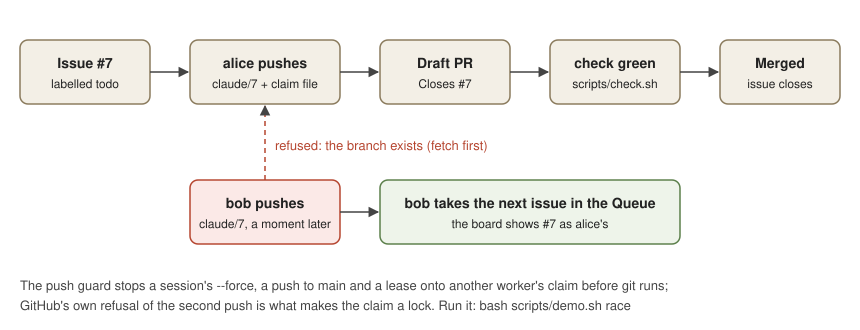
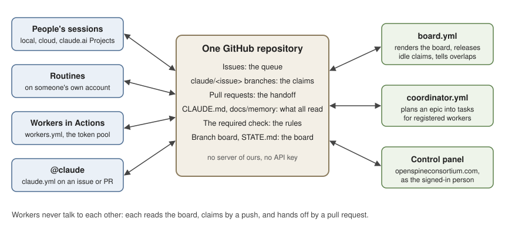

# What Symphony can do

This page shows everything a Symphony project can do today, what sets it apart, and cases you can follow or hand to someone new. It began as the owner's handout of 2026-10-19 and became a demo on 2026-10-20: a part you can run in a minute, two figures, a capability list where every line links to the file, workflow or page that does the work, and seven cases with their steps. It is written from the code on the default branch. A line marked "not built yet" or "waits on" says exactly what is missing.

## Try it in a minute

The demo runs the claim protocol itself on your machine, in about a second: two workers race for one issue, the push guard judges six pushes, and the board is rendered from a snapshot. It needs no network, no GitHub sign-in, no Claude account and no key of any kind, because a local bare repository stands in for GitHub; what refuses the second claim is git's own rule that a push may not replace history it does not contain, which is the rule GitHub applies. Pick the way that suits you:

| Way | What to do | Wait | Needs |
| --- | --- | --- | --- |
| A clone you already have | `bash scripts/demo.sh`, or one part: `race`, `guard` or `board` | about 1 second | git and Python 3.12 |
| A Codespace in the browser | Open [the demo Codespace](https://codespaces.new/OpenSpineConsortium/symphony-template?quickstart=1&devcontainer_path=.devcontainer%2Fdemo%2Fdevcontainer.json) and press **Create codespace**; the terminal runs the demo when it opens | under 2 minutes the first time; resuming is quicker | a GitHub account that can read this repository; the account's own Codespaces quota (120 core-hours a month on a personal Free plan) |
| Google Colab | Open [the notebook in Colab](https://colab.research.google.com/github/OpenSpineConsortium/symphony-template/blob/main/docs/start/demo.ipynb), tick "Include private repos" and authorize when Colab asks, then Runtime, Run all | seconds once a runtime is connected | a Google account, and GitHub access to this repository, since it is internal |

[scripts/demo.sh](../../scripts/demo.sh) is the script, [.devcontainer/demo/devcontainer.json](../../.devcontainer/demo/devcontainer.json) the Codespace, and [demo.ipynb](demo.ipynb) the notebook, which clones the public library [symphony-protocol](https://github.com/OpenSpineConsortium/symphony-protocol) at v0.5.1 and runs the same three parts from it. The Codespace link names the demo configuration, so the setup Codespace of [codespace.md](../setup/codespace.md), which stays the repository's default configuration, is untouched. The comparison of these and other sandboxes, and why there is no zero-wait page yet, is [interactive-sandbox.md](../research/interactive-sandbox.md).

### What the demo shows

1. **The race.** alice and bob each branch `claude/7` from main and commit a claim file naming themselves, as the claim skill does. alice's push is accepted; bob's is refused by origin (`! [rejected] claude/7 -> claude/7 (fetch first)`), so bob takes another issue. Nobody overwrote anybody, and nothing but git decided it.
2. **The guard.** Claude Code runs [tools/guard_push.py](../../tools/guard_push.py) before every shell command a session types, wired in [.claude/settings.json](../../.claude/settings.json). From bob's clone it refuses `git push origin main`, `git push --force origin claude/7`, `git push origin +claude/7` and `git push origin claude/07` (a name that reads as a claim and claims nothing), each with the rule it breaks. Then bob fetches, the moment git itself would let `--force-with-lease` take alice's branch, and the guard refuses that too: "claude/7 on origin is alice's claim (its claim file docs/agents/claims/7.md says so)". A plain push of a fresh `claude/8` is allowed.
3. **The board.** [tools/board.py](../../tools/board.py) `--dry-run` renders STATE.md from [tests/fixtures/board.json](../../tests/fixtures/board.json): Claims, Open pull requests, Overlaps, the Queue, Given to workers, Blockers and Recently merged, exactly as [board.yml](../../.github/workflows/board.yml) writes it to the branch `board` from GitHub's API. In the notebook the snapshot is a cell you can edit and run again.

[tests/test_demo.py](../../tests/test_demo.py) runs the script in the required check, so the demo cannot drift from the code it shows.

## What is different about it

- **The repository is the project.** The instructions, the goal, the memory, the board and the rules live as files in one GitHub repository. Every Claude session reads them at start, whether it runs locally, in the cloud, in a claude.ai Project, as a routine or as a worker in GitHub Actions. Nothing lives in one person's chat history or one account ([how-this-repository-works](../memory/how-this-repository-works.md)).
- **Many workers coordinate through GitHub alone.** An issue is a task. The first push of `claude/<issue>` is the claim, and GitHub refuses a second push of the same name, so two workers never hold one issue. The board (STATE.md on the branch `board`) is the shared state, and a pull request is the handoff. Any number of people, sessions, routines and Actions workers, on any number of Claude accounts, work one repository without talking to each other ([PROTOCOL.md](../agents/PROTOCOL.md)).
- **No server of ours and no API bill.** Claude in CI runs on a subscription token from `claude setup-token`, never an API key. The board, the coordinator's releases and the metrics run in GitHub Actions on the repository's own token.
- **The rules are tested like code.** The claim protocol is one public Python library with no dependencies, symphony-protocol. It is vendored here, checked against its hashes, and validated by a harness that runs every interleaving of a few workers against an oracle written from the spec. Every repository's required check holds it.
- **Work and benchmark share one file.** An agent written for daily work is the same file coordbench and flowbench measure. The repository is a place to build software and a place to compare agent designs on that same work.
- **It reaches past the code.** Claude works on a university's computing cluster, on the owner's OneDrive and Word documents, and on licensed literature, each under its own owner's rules (below).

## Capabilities

### Coordinating work

| What | How | Where |
| --- | --- | --- |
| Claim, work in the open, finish | Claim branch, draft pull request, the required check, merge | [PROTOCOL.md](../agents/PROTOCOL.md), [the claim skill](../../.claude/skills/claim/SKILL.md) |
| The board | Rewritten on every issue, push and pull request event; the Queue, Given to workers, Blockers, Overlaps | [board.yml](../../.github/workflows/board.yml), [`/board`](../../.claude/commands/board.md) |
| Workers of every kind | A person's sessions by GitHub login, routines and Actions workers as files under .github/symphony/workers/, added by the "Add a worker" form | [WORKERS.md](../agents/WORKERS.md), [workers.yml](../../.github/workflows/workers.yml), [the form](../../.github/ISSUE_TEMPLATE/worker.yml) |
| The coordinator | Releases idle claims and tells overlapping work in the board's own run; Claude in coordinator.yml plans an epic into tasks for registered workers | [board.yml](../../.github/workflows/board.yml), [coordinator.yml](../../.github/workflows/coordinator.yml) |
| Push guard | A hook refuses a push to the default branch, to another worker's claim, and every forced push but a lease on your own claim | [tools/guard_push.py](../../tools/guard_push.py) |
| Shared memory and research | One fact per file under docs/memory/, findings under docs/research/, both by pull request | [MEMORY.md](../memory/MEMORY.md), [research](../research/README.md) |
| Crowd mode | Volunteers each on their own Claude account; the project never holds anyone's credential | [crowdsourcing.md](../setup/crowdsourcing.md) |

### Running Claude autonomously

| What | How | Where |
| --- | --- | --- |
| @claude on an issue or pull request | [claude.yml](../../.github/workflows/claude.yml) on the repository's subscription token | [claude-action.md](../setup/claude-action.md) |
| Workers in GitHub Actions | Registered workers take queued tasks on their own, each within the turns per run and the runs in a row its file sets | [workers.yml](../../.github/workflows/workers.yml) |
| A pool of Claude accounts | Up to 32 token slots as organization secrets; tools/pool.py picks the slot with the most room in its five-hour and seven-day windows, steered per slot (model, effort, paused) | [the token pool](../memory/the-token-pool.md), [pool.yml](../../.github/workflows/pool.yml), [tools/pool.py](../../tools/pool.py) |
| Adding a token with no terminal | The control panel's Tokens page mints one on an Actions runner, and the token leaves it only sealed; one token per person, lent to the repositories they choose and revoked any time | [token.yml](../../.github/workflows/token.yml), [claude-tokens.md](../setup/claude-tokens.md) |
| What the work cost | A Symphony-Usage line on each session's commits and a usage artifact per Actions run, summed by metrics.yml with alone-versus-parallel ratios | [field metrics](../memory/field-metrics.md), [metrics.yml](../../.github/workflows/metrics.yml) |
| Profiling a session | Context, tool calls, re-reads and time, as counts only | [tools/profile.py](../../tools/profile.py) |

### Agents and benchmarks

| What | How | Where |
| --- | --- | --- |
| Agents as files | Claude Code subagent files under .claude/agents/; reviewer, developer and tester ship with it | [AGENTS.md](../agents/AGENTS.md) |
| Importing your own agent | The Agents workflow imports an agent file by pull request, checked for its name, description and tools | [agents.yml](../../.github/workflows/agents.yml), [tools/agents.py](../../tools/agents.py) |
| Giving agents tokens | .github/symphony/accounts.json maps agents and workers to token slots by name | [agents](../memory/agents.md) |
| Benchmarking coordination | coordbench runs CooperBench's task pairs under each way of coordinating (solo, coop, team, sdlc and others) and scores them with CooperBench's own evaluation | [benchmark.md](benchmark.md) |
| Benchmarking an agent design | `coordbench --agent-file` and a flowbench stage's agent run the same file used in daily work; flowbench builds on SWE-bench's task repository | [coordbench](https://github.com/OpenSpineConsortium/coordbench), [flowbench](../research/flowbench/README.md) |
| Leaderboard | Issues a token closes carry token:<id>, crediting the token and its owner | [the token pool](../memory/the-token-pool.md) |

Every benchmark run spends the account's usage, so none starts without the owner's word and a number.

### The control panel

The site's [/symphony/control/](https://openspineconsortium.com/symphony/control/) drives a repository as the signed-in person through GitHub's API: the board, tasks, @claude, workers, pull requests, workflow runs, tokens, the Share tab, Dependencies, Folders and the Explorer, Explore, Notebooks, and the Ask Claude bar, which answers read only and offers the panel actions its answer names as buttons ([the control panel](../memory/the-control-panel.md)). Sign in with GitHub goes through a stateless Worker. Each feature ships only after the Apps' privacy statement describing it is live.

### Getting a project started

| What | How | Where |
| --- | --- | --- |
| One press | Install the App, press Create on the form, and the run opens the adoption pull request and merges it | [the front door](../memory/the-front-door-is-one-press.md) |
| Settings applied for you | Symphony Setup applies the repository's settings and pins the required check in the same run; every setting is on one tracked list in symphony-start | [scripts/setup-repo.sh](../../scripts/setup-repo.sh), [symphony-start](https://github.com/OpenSpineConsortium/symphony-start) |
| From Claude Code | `/symphony:new` makes the repository, installs both Apps and opens a cloud session | [claude-code.md](claude-code.md) |
| An existing repository | The protocol alone, or the plugin, added to code you already have | [existing-repo.md](existing-repo.md) |

### Wayne State's grid

[grid.yml](../../.github/workflows/grid.yml) runs one command on a WSU compute node through a runner chain that hpcworker serves as Slurm jobs. The output comes back as the job's log and an artifact. [grid-gate.yml](../../.github/workflows/grid-gate.yml) starts, reads or stops the chain over an ssh key whose forced command takes only those three words. No Claude token goes to the grid ([grid.md](../setup/grid.md), [the grid](../memory/the-grid-runs-a-job-through-beethoven.md)).

### OneDrive, notebooks and Word

| What | How | Where |
| --- | --- | --- |
| Native OneDrive access | Wayne State approved the SymphonyBoard Folders app on 2026-10-19, so the panel's Folders tab and the drive organizer read a WSU OneDrive directly through Microsoft Graph under the owner's own Microsoft sign-in, which the owner confirmed live on 2026-10-20; the connector walk is retired | [drive organizer](../memory/drive-organizer.md), [OneDrive on Graph](../research/onedrive-direct-graph.md) |
| Organizing a drive | The whole drive read into a catalog, sorted into proposed projects, each a possible repository; files move only on the owner's own go, and every move can be undone | [the drive-organize skill](../../.claude/skills/drive-organize/SKILL.md) |
| Notebooks | A group of drive files held together, as NotebookLM does, in a private repository that points at them by id and never moves them, with research, drafts and references | [the notebook skill](../../.claude/skills/notebook/SKILL.md), [tools/notebook.py](../../tools/notebook.py) |
| Revising Word documents | Revisions written as tracked changes in a copy beside the file, never over a file the owner changed; several reviewers each as their own author | [tools/docx_review.py](../../tools/docx_review.py), [the lens-review skill](../../.claude/skills/lens-review/SKILL.md) |
| Citations in Word | Citations inserted as tracked changes, either as Word's own citations with the document's source list, where Insert Bibliography or Update Field builds the reference list (tested in Word desktop, 2026-10-19), or as Zotero fields naming each item in the owner's library | [tools/docx_cite.py](../../tools/docx_cite.py) |
| References from a citation manager | BibTeX or RIS from Mendeley, EndNote or Zotero, or Zotero's web API with each item's library link, read into references.json | `tools/notebook.py refs` |
| Syncing both ways | A connected Google Drive or OneDrive synced through drive-sync.yml | [drive-sync.yml](../../.github/workflows/drive-sync.yml), [drive-sync](../research/drive-sync.md) |

The Mendeley app, a Mendeley sign-in in the panel, is planned and not built yet ([mendeley-sign-in](../research/mendeley-sign-in.md)). Zotero's Refresh in Word is not tested yet.

### Licensed literature (Elsevier)

The institution's Elsevier access (ScienceDirect and Scopus, with an API key and an institution token) may be read by Claude for academic work, as the university's library and Elsevier itself confirmed on 2026-10-19, on two conditions: the token and the text are never made public, and no model is ever trained on them. The key and the token are kept as secrets the owner sets, an Actions secret for private repositories or a cloud environment's variable, and are used only in private places, never in a public repository, a log, a URL or browser code. The template has no Elsevier client of its own yet: a session reads with the secrets where the work needs them ([notebooks research](../research/notebooks.md)).

## Cases

Each case says who it is for, what happens, and the steps that make it happen, with the file or page behind each step. The first runs anywhere with no account; the rest need a Symphony repository of your own, made as [solo.md](solo.md) or the front door says, and a step that spends Claude usage says so.

### 1. See the protocol hold, with no account

For anyone deciding whether to trust the claim rule. Run `bash scripts/demo.sh race`, or the Codespace or Colab above. Then change the script's `push_claim bob 7` to come first, and bob holds the issue instead: the order of arrival decides, nothing else. The validation harness in symphony-protocol checks the same property over every interleaving of a few workers ([validation/DESIGN.md](https://github.com/OpenSpineConsortium/symphony-protocol/blob/main/validation/DESIGN.md)).

### 2. A lab with several students

The PI makes the repository with one press ([the front door](../memory/the-front-door-is-one-press.md)). Each student works under their own Claude account and GitHub login, as their own worker, `worker:<their login>`.

1. The PI files tasks with the [Task form](../../.github/ISSUE_TEMPLATE/task.yml), labelled todo, or one issue labelled epic for the coordinator to plan ([coordinator.yml](../../.github/workflows/coordinator.yml)).
2. Each student's session reads the board at start (the session hook prints it) and claims with [the claim skill](../../.claude/skills/claim/SKILL.md); case 1 is why two never hold one task.
3. When two students' pull requests change the same file, the board lists it under Overlaps with the order to land them, and the coordinator tells each pull request once.
4. A student who goes quiet for 24 hours loses the claim: the board's run releases it with a comment saying what the branch holds, and the next student carries it on ([PROTOCOL.md](../agents/PROTOCOL.md), Release).

### 3. Work overnight

The owner queues tasks labelled todo before bed. Registered workers in Actions ([workers.yml](../../.github/workflows/workers.yml), on its schedule or a todo label) take them on the repository's token or [the token pool](../memory/the-token-pool.md), open pull requests and pass the required check. Each stops at the runs in a row its file under .github/symphony/workers/ allows ([WORKERS.md](../agents/WORKERS.md)). In the morning the board shows what landed and what waits. This spends the Claude accounts' usage.

### 4. A paper with references you can trace

The draft sits on OneDrive. A notebook repository points at it and its data by id and never moves them ([the notebook skill](../../.claude/skills/notebook/SKILL.md)). `python3 tools/notebook.py refs` reads a BibTeX or RIS export from Mendeley, EndNote or Zotero into references.json; Claude drafts in the notebook and [tools/docx_cite.py](../../tools/docx_cite.py) writes each citation into a copy of the document as a tracked change, so Word builds the reference list itself and the owner accepts or rejects each change in Word.

### 5. A job on the cluster

A task needs a GPU. Run [grid.yml](../../.github/workflows/grid.yml) from the repository's Actions tab with a command (its default is `bash scripts/check.sh`); it goes to a WSU compute node as a Slurm job, and the log and an artifact come back to the run, with no credential of Claude's on the cluster ([grid.md](../setup/grid.md) has the one-time setup).

### 6. Compare agent designs

A team writes a reviewer agent and imports it by pull request through [agents.yml](../../.github/workflows/agents.yml)'s import input, which checks its name, description and tools ([AGENTS.md](../agents/AGENTS.md)). Registered with `"runs": "pull_request"`, it runs on each pull request from this repository as it is opened, reopened or marked ready. With the owner's word and a number, the same file runs in [coordbench](https://github.com/OpenSpineConsortium/coordbench) (`--agent-file`) or a [flowbench](../research/flowbench/README.md) stage against the default agent on the same tasks, so the result is a measured comparison of the design, not an impression. The full CooperBench coordination run is recorded in [curse-of-coordination-full-run.md](../research/curse-of-coordination-full-run.md).

### 7. Sort a drive into projects

Claude reads a whole OneDrive into a catalog, reads a sample of the files and proposes projects, each with tasks and a possible repository ([the drive-organize skill](../../.claude/skills/drive-organize/SKILL.md)). Nothing moves until the owner reads the list of moves and says go, and every move can be undone.

## What it never does

It never pushes to the default branch, never holds an API key for Claude, and never puts anyone's credential in a file. It never moves or overwrites the owner's files without their word. It never makes licensed text public, and it never starts a paid run without the owner's word.
